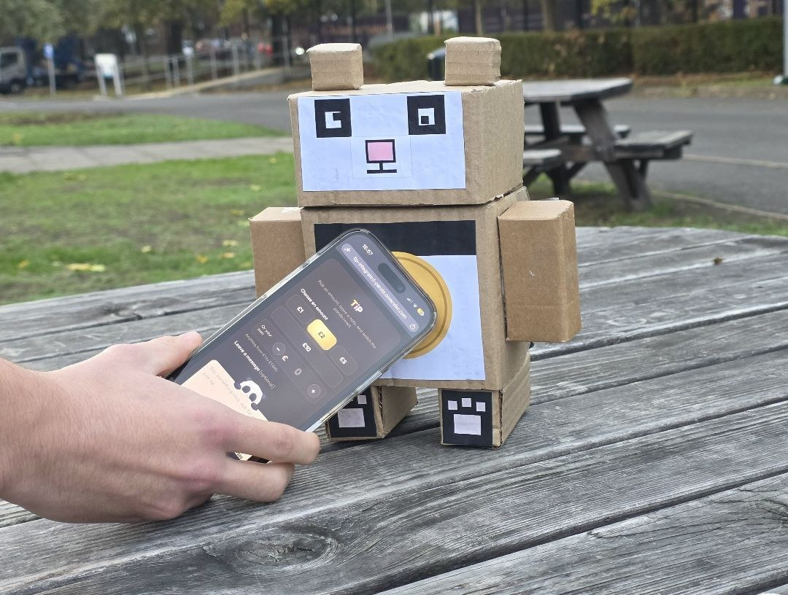
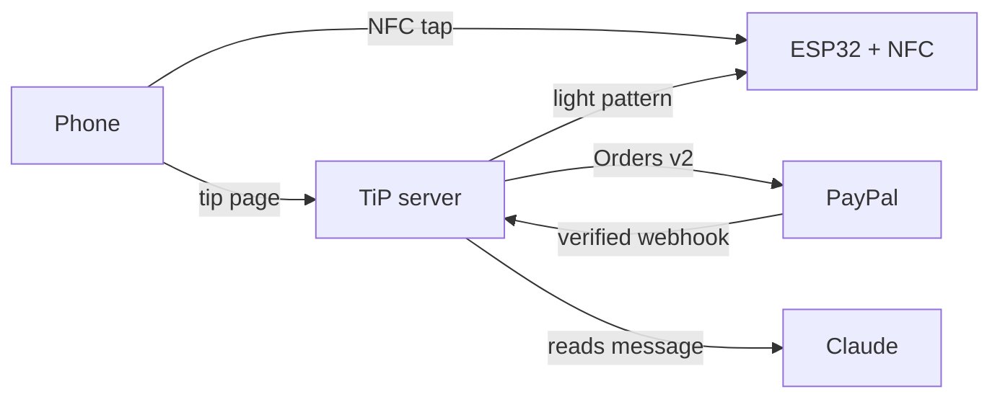

<div align="center">



# TiP

**Tap a coin. Leave a tip. Watch the panda react.**

[](https://github.com/BozhidarBoyadzhiev/TiP/actions/workflows/ci.yml)


[Live demo](https://tip-integrated-panda.onrender.com/t/demo-panda) ·
[Video](https://www.youtube.com/watch?v=6cuMdTUvuvM) ·
[How it works](#how-it-works) ·
[Run it](#run-it-locally) ·
[Docs](#docs)

</div>

## What is TiP?

TiP is a contactless tipping device. An ESP32 with an NFC board acts as a
tag. Tap it with a phone and a tip page opens. Pick an amount, write a
message if you like, and pay with PayPal.

Claude reads the message and decides what kind it is: warm, playful, a
request, or plain. The device answers with its own light pattern for each
kind. Bigger tips get a longer show.

Abusive messages get one plain blink and nothing more. The owner never sees
them unless they choose to.

The panda is just the case. We made it from cardboard because a tip jar
should look friendly. The same board fits a busker's case, a shop counter
or a delivery bag.

## How it works



1. The phone taps the coin and opens the tip page.
2. PayPal takes the payment. The server confirms it from PayPal's capture answer or a verified webhook.
3. Claude reads the message. Its answer is checked and never trusted blindly.
4. The device plays the pattern. The owner sees the tip live.

## Try it

The live demo runs on PayPal's sandbox. No real money moves.

1. Open [the virtual panda](https://tip-integrated-panda.onrender.com/p/demo-panda)
   on your computer. It plays the same lights as the real one.
2. Open [the tip page](https://tip-integrated-panda.onrender.com/t/demo-panda)
   on your phone, or in a second tab.
3. Pick an amount and write a message. Try a kind one, a joke, or a song
   request.
4. Choose **Debit or Credit Card** and pay with this test card:

   | Card number | Expiry | CVC |
   |---|---|---|
   | `4105 1749 3451 7748` | `10/2031` | any 3 digits |

   Any name and address will do.
5. Watch the panda. Each kind of message has its own light, and a bigger
   tip plays longer.

To see the owner side, open the read only demo dashboard from the link
under the tip card.

**Judges:** your access code is on the Devpost page. It gives you a
private panda and dashboard, and a side by side view of all three.

## Run it locally

You need Java 21, Docker Desktop, a PayPal sandbox app and an Anthropic API
key.

**1. Fill in `.env`** (start from `.env.example`):

| Variable | Where to get it |
|---|---|
| `PAYPAL_CLIENT_ID`, `PAYPAL_CLIENT_SECRET` | PayPal developer dashboard, Apps & Credentials, your sandbox app |
| `PAYPAL_WEBHOOK_ID` | The webhook you add to that app, see [docs/SETUP.md](docs/SETUP.md). The app does not start without it |
| `ANTHROPIC_API_KEY` | console.anthropic.com, API keys. Or set `TIP_AI_ENABLED=false` |
| `TIP_DEMO_OWNER_EMAIL`, `TIP_DEMO_OWNER_PASSWORD` | Your choice. The password needs 12 to 72 characters |
| `TIP_DEMO_DEVICE_SLUG` | Your choice. It becomes the URL, like `/t/my-panda` |
| `TIP_DEMO_DEVICE_SECRET` | Generate it with the command below |

```bash
openssl rand -base64 32 | tr '+/' '-_' | tr -d '='
```

**2. Start the database**

```bash
docker compose up -d
```

**3. Start the app**

```bash
./gradlew bootRun
```

**4. Open** `http://localhost:8080/t/<your slug>` and send a tip.

Webhooks, sample data, the fake device and every setting are in
[docs/SETUP.md](docs/SETUP.md).

## Tests

```bash
./gradlew build
```

Docker must be running. PayPal and Claude are stubbed, so no keys are needed.

## The device

An ESP32 DevKit, a PN532 NFC board and a power bank inside a cardboard panda. The
DevKit's own blue LED is the light. How to build the panda is in
[panda/README.md](panda/README.md). Build and flash steps are in
[firmware/README.md](firmware/README.md).

## Docs

- [Setup](docs/SETUP.md): everything about running it yourself
- [Architecture](docs/ARCHITECTURE.md): design, security and failure modes
- [Device protocol](docs/DEVICE_PROTOCOL.md): how the device talks to the server
- [Owner channel](docs/OWNER_CHANNEL.md): how the dashboard hears about changes live
- [Deployment](docs/DEPLOYMENT.md): running it on Render
- [Firmware design](firmware/DESIGN.md): how the device firmware works inside
- [Build the panda](panda/README.md): the cardboard case and where the boards go
- [How it was built](docs/WORKFLOW.md): the brief and review process

## Licence

Apache 2.0. See [LICENSE](LICENSE).