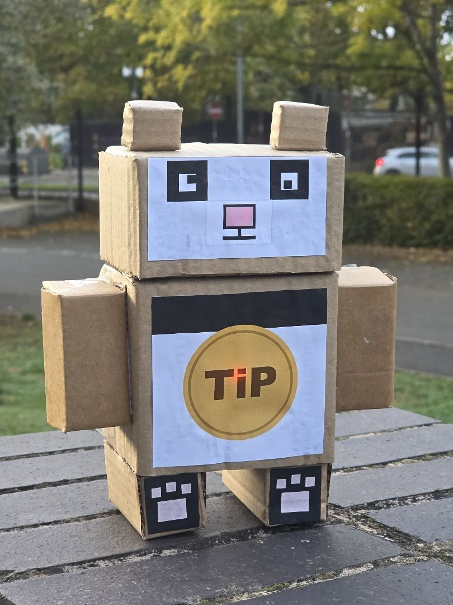
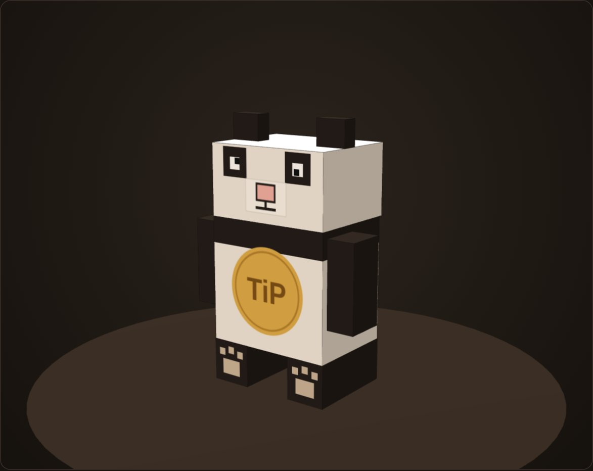
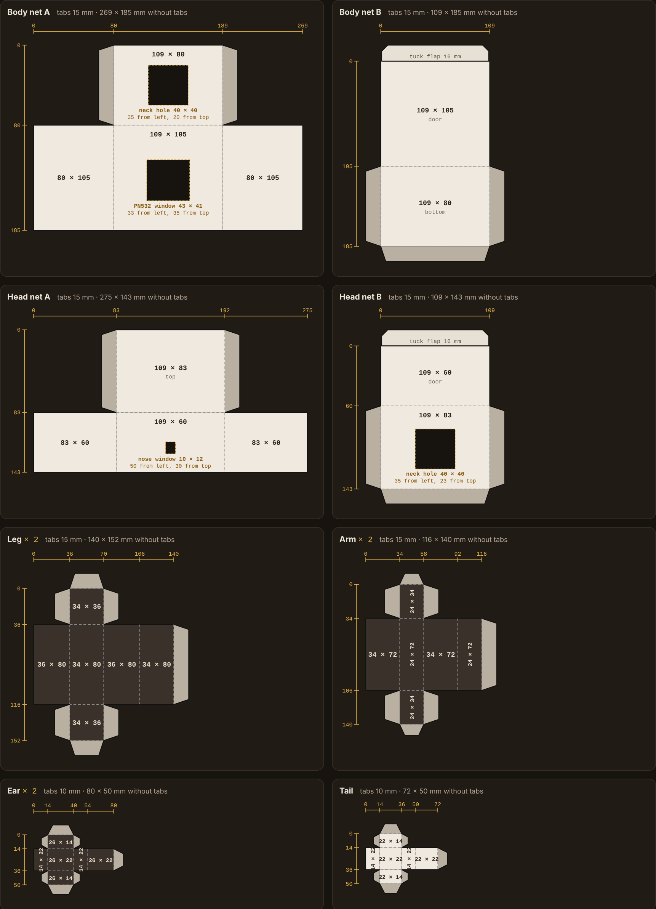
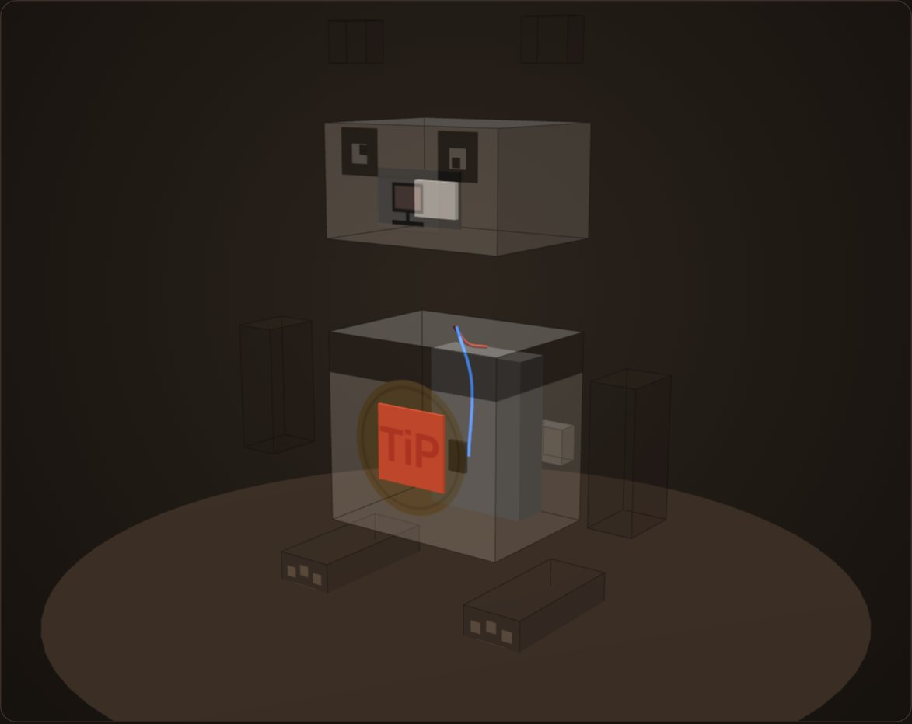
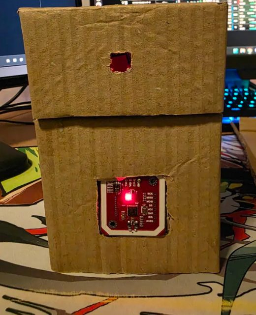
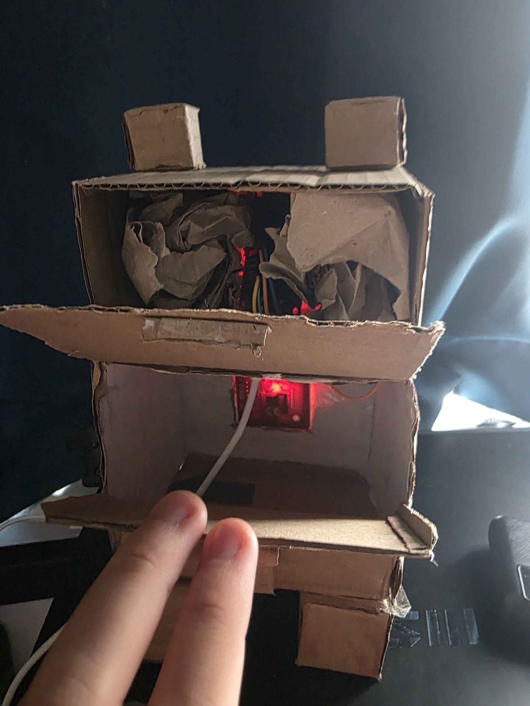
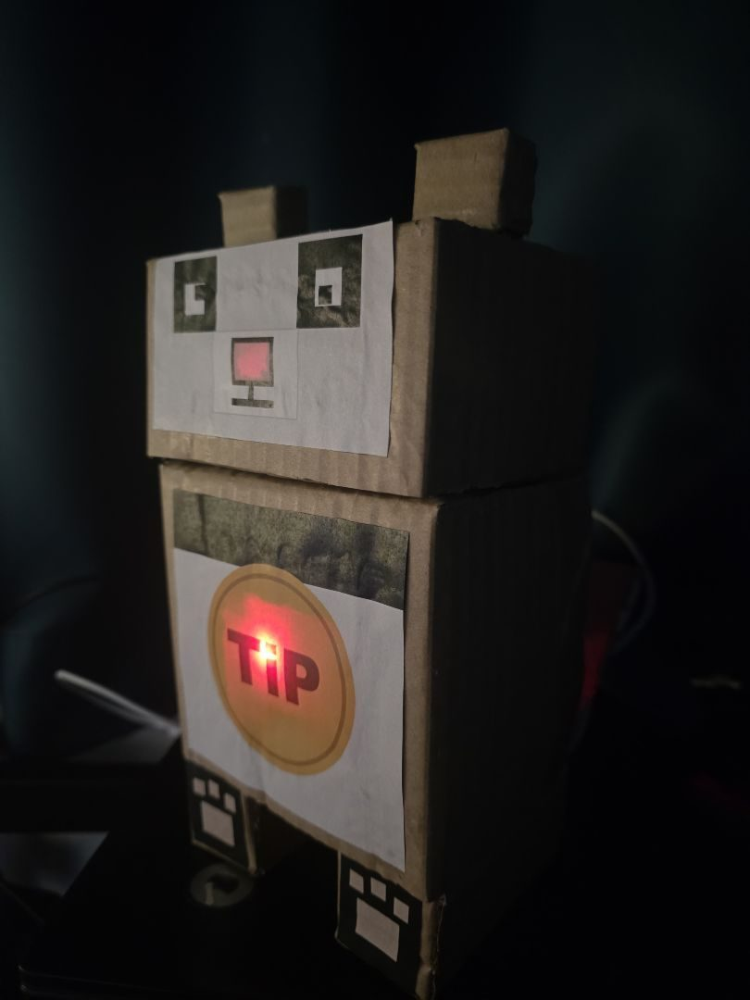

# Build the panda

The panda is nine cardboard boxes stuck together. Each box is one flat shape (a net) drawn on cardboard, cut out and folded. You need no special tools, and nothing here has to be followed exactly. The only things that matter are that the boards fit inside and that the PN532 and the ESP32's LEDs sit behind their windows.

The wiring and the firmware are in [firmware/README.md](../firmware/README.md).

## What you need

- Thin corrugated cardboard, like a delivery box. Thin card is much easier to cut and fold than thick card.
- A pencil, a metal ruler and a craft knife.
- Glue and some tape.
- One A4 page of printed panel art for the face and the coin.
- The electronics from [firmware/README.md](../firmware/README.md): an ESP32 DevKit, a PN532 board, a power bank and a USB to 2 pin lead.

## The boxes

Outside sizes in mm, as width x height x depth:

| Box | How many | W x H x D | Where it goes |
|---|---|---|---|
| Body | 1 | 109 x 105 x 80 | In the middle, with the PN532 behind the coin |
| Head | 1 | 109 x 60 x 83 | On the body, with the ESP32 behind the nose |
| Leg | 2 | 34 x 36 x 80 | Under the body |
| Arm | 2 | 24 x 72 x 34 | On the body sides |
| Ear | 2 | 26 x 22 x 14 | On top of the head |
| Tail | 1 | 22 x 22 x 14 | On the back |

The body and the head are made from two nets each so their backs can be doors. Every other box is one net.

## Tips

- **Drawing.** The gold numbers on each net are distances from the first corner. Mark them all along one line and join them up with the ruler, so you never have to add sizes up.
- **Glue tabs.** The grey strips are tabs that fold inside and hold the box together. Cut their corners off at an angle so they fold in without catching.
- **Folding.** Press each fold line first with the back of the knife or a dry pen. The card then folds cleanly instead of cracking.
- **Joining.** Glue holds the boxes best, but tape is fine wherever it is easier. On the small boxes, close the long side first and then the ends.
- **Holes.** Cut the PN532 window, the nose window and the two neck holes before you fold. The neck holes line up so the wires can pass from the body into the head.
- **Doors.** Leave the backs of the body and the head unglued. Each is hinged at the bottom with a flap at the top that tucks in like a cereal box, so you can reach the boards later.
- **Looks.** Scuffs and wobbly edges are fine. A friendly panda does not need to be perfect.

## The face and the coin

[panel-art.pdf](panel-art.pdf) has the coin and shoulder band for the body, the face for the head and paw pads for the legs. Print it at 100% and check the 50 mm bar with a ruler, then glue the pieces on. The coin goes over the PN532 window and the pink nose over the nose window.

## The electronics

- **PN532 in the body front window**, antenna side out and level with the outside, taped in from inside. A phone has to come within about 2 mm of the antenna, so it sits in a hole with only the paper coin in front of it. Its red power light shows through the coin and marks the spot to tap.
- **ESP32 in the head behind the nose.** Its own blue LED is the panda's light, so the LEDs need to sit behind the nose window. The head is only 60 mm tall, so the board lies on its side. Crumpled paper or foam tape keeps it in place.
- **Power bank** lying inside the body, away from the antenna.
- Leave a little spare wire between the head and the body so the head door still opens.
- Never glue a board. Tape and paper hold everything, so it can all come out again.

Tap the coin with a phone before you glue the head on, while everything is easy to reach. [firmware/README.md](../firmware/README.md) shows how to test it.

## Print the nets instead

[nets-print.pdf](nets-print.pdf) has the same nets on six A4 sheets with the face and the coin already on them. Print them on thin card, or on paper glued onto cardboard. With printed card you can skip the PN532 window and tape the board behind the printed coin, as long as it stays within about 2 mm of the surface. We drew ours by hand, so this way is untested.

## How ours came together

The bare boxes with the PN532 in its window:

Inside, with the doors open:

With the face and the coin on:

## Why boxes

Anyone can draw a box with a ruler, so the panda is easy to copy and easy to fix. It is a prototype. A real product could use a sturdier case and different parts, and the server would not change.

## Credits

Bozhidar built the panda with help from [@Edilini05](https://github.com/Edilini05).
